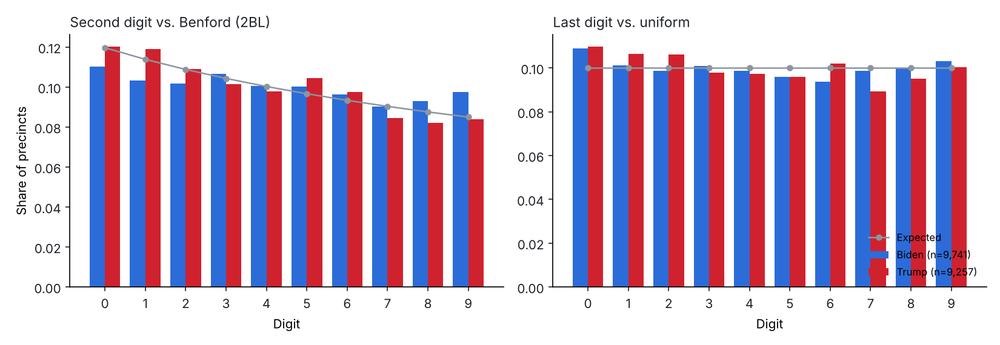
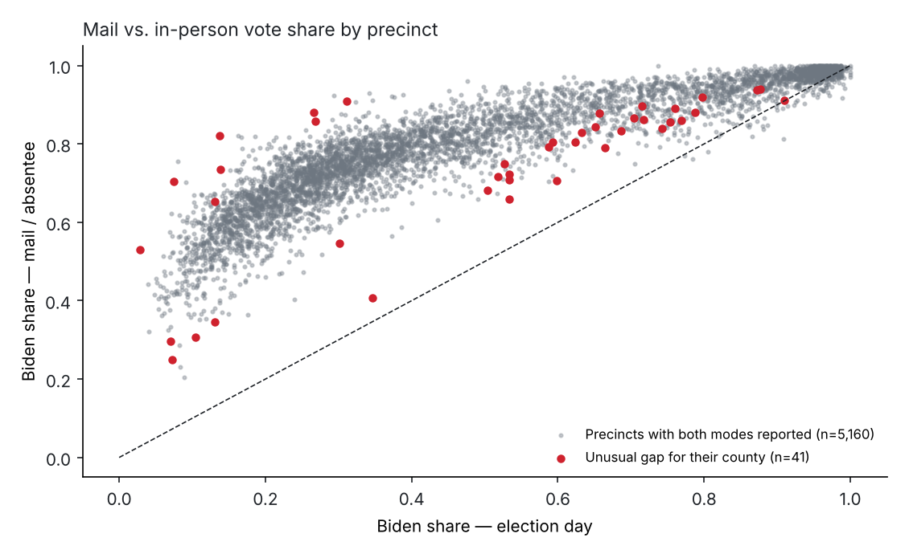

# Election Anomaly Detection

A small, tested Python package for **statistical screening of precinct-level election returns**, applied to the 2020 US presidential election in Pennsylvania (10,438 precincts, 67 counties).

It implements the standard *election-forensics* toolkit (Benford first- and second-digit tests, last-digit uniformity, within-county robust outliers), plus a **size-preserving Monte Carlo null** that shows when a "Benford violation" is just an artefact of precinct sizes.

> **Scope.** These tests flag *statistical irregularities*, not fraud. Digit tests react to precinct size, competitiveness and turnout patterns (Deckert, Myagkov & Ordeshook, 2011; Mebane, 2011). A flag is a reason to look at a precinct, nothing more.

> 🇪🇸 *Paquete en Python para tamizaje estadístico de resultados electorales por mesa/precinto: pruebas de dígitos (Benford, último dígito), un nulo de Monte Carlo que respeta el tamaño de los precintos y detección robusta de atípicos dentro de cada condado. Aplicado a Pensilvania 2020.*



## Key results

**Data check.** After removing a county-level `TOTAL` row that double-counts Philadelphia in the source file, the precinct totals add up to 3,460,310 (Biden) and 3,378,095 (Trump), within 0.06 % of the certified results (3,458,229 and 3,377,674).

**1. A naive Benford test "rejects", and the right null says otherwise.**

| Test | Candidate | Classical p-value | Null sims rejected at 1 % | Monte Carlo p |
|---|---|---:|---:|---:|
| Second digit (2BL) | Biden | 6.8 × 10⁻⁷ | **75.8 %** | 0.044 |
| Second digit (2BL) | Trump | 0.040 | 0.2 % | 0.052 |
| Last digit | Biden | 0.094 | 1.4 % | 0.132 |
| Last digit | Trump | 1.8 × 10⁻⁴ | 8.2 % | 0.012 |

When each precinct count is replaced by honest Poisson noise around its own value, the classical 2BL test still rejects in **three out of four** simulated Biden elections. Biden's vote is concentrated in very large and very small precincts (Philadelphia vs. rural areas), and Benford's law does not hold exactly for that size mix. Against the correct null, the deviation is marginal.

**2. The last-digit signal comes from small precincts.** Trump's last-digit p-value moves from 0.0002 to 0.048, 0.056 and 0.20 when the minimum count goes from 10 to 50, 100 and 200 votes. Small counts in the tens do not have uniform last digits. The test needs a size threshold.

**3. Within-county outliers.** Of 9,391 precincts with ≥ 100 two-party votes, **135 (1.3 %)** are flagged at |robust z| > 4:

- 100 are flagged on vote share. Of these, 72 are in Philadelphia, where the county is not a homogeneous reference group: neighbourhoods are polarised in both directions. A finer reference (ward or demographic covariates) is the obvious next step.
- 41 are flagged on the gap between mail and in-person vote share. This uses only precincts with ≥ 25 votes in each mode, from the 31 counties that report the split.



The full list is in [`reports/flagged_precincts.csv`](reports/flagged_precincts.csv) and every number above is in [`reports/summary.json`](reports/summary.json).

## Package layout

```
src/electoral_forensics/
├── data.py       # load OpenElections CSVs, drop total rows, precinct × candidate table, vote-mode split
├── digits.py     # Benford 1BL/2BL, last digit, chi-square + MAD, size-preserving Monte Carlo null
├── outliers.py   # median/MAD robust z-scores within county, vote-share and mode-gap flags
└── report.py     # CLI: runs everything, writes figures, CSV and JSON
tests/            # pytest: known Benford moments, digit extraction, planted anomalies, rounding detection
```

## Quick start

```bash
pip install -e ".[dev]"
pytest                               # 10 tests
electoral-report --out reports       # downloads PA 2020 from OpenElections
# or any other OpenElections file:
electoral-report --input path/to/20201103__xx__general__precinct.csv --out reports_xx
```

## Data

[OpenElections](https://github.com/openelections) precinct-level results (`openelections-data-pa`, 2020 general). The same source is mirrored on Kaggle as *Open Elections Data: USA*.

## Methods in brief

- **Second-digit Benford (2BL)**: expected mean 4.187 (Mebane, 2006). It applies to counts ≥ 10.
- **Last digit**: uniform under honest counting when counts are large enough. Rounding or invented numbers show up as excess 0s and 5s (Beber & Scacco, 2012). The tests include a rounding-detection check.
- **Size-preserving null**: Poisson redraws of each observed count, 500 simulations. It gives a Monte Carlo p-value and the share of honest simulations that the classical test would reject.
- **Robust z-score**: (x − median) / (1.4826 · MAD) within county. It is insensitive to the outliers it is trying to find.

## Limitations

County is a coarse reference group for large heterogeneous counties. Vote-mode breakdowns are only available for 31 of 67 counties. There are no registration or turnout figures in this file, so turnout-based fingerprints (Klimek et al., 2012) are not included.

## References

- Beber, B. & Scacco, A. (2012). What the numbers say: A digit-based test for election fraud. *Political Analysis*, 20(2).
- Deckert, J., Myagkov, M. & Ordeshook, P. (2011). Benford's Law and the detection of election fraud. *Political Analysis*, 19(3).
- Klimek, P. et al. (2012). Statistical detection of systematic election irregularities. *PNAS*, 109(41).
- Mebane, W. (2006). Election forensics: Vote counts and Benford's Law. Political Methodology Society summer meeting.
- Mebane, W. (2011). Comment on "Benford's Law and the detection of election fraud". *Political Analysis*, 19(3).

## Stack

Python · NumPy · pandas · SciPy · matplotlib · pytest · GitHub Actions

**Author:** Mateo Aranguren
